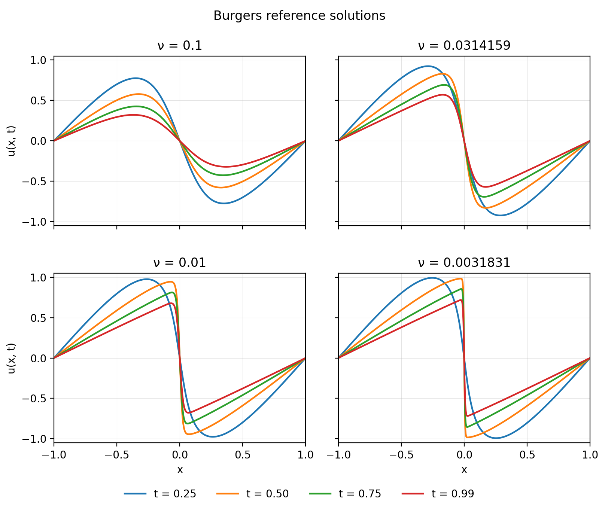

# Peer-review

We conducted a controlled comparison of collocation-point sampling methods for
PINNs [1](#references) solving the one-dimensional viscous Burgers equation. The experiment asks
whether gradient-adaptive sampling becomes more beneficial as solutions develop
sharper features, and whether adding Gaussian diffusion to point motion improves
PACMANN [2](#references).

Starting from the released PACMANN implementation, we compared fixed Hammersley,
random resampling, RAD [3](#references), PACMANN-Adam, and PACMANN with diffusion across five
viscosities. Each case used ten paired seeds with matched architectures,
initialization, point budgets, and training schedules, producing 250 models.
Diffusion strengths were tuned before the 10-seed study on separate development seeds. We assessed final
solution accuracy against generated numerical references and PDE-residual error
on common fixed evaluation grids.

The [README](../README.md) gives installation and execution commands; this guide
explains the scientific choices and where to inspect them.

## Questions and problem

1. Does the relative benefit of point-adaptive sampling change across solution
   sharpness regimes, for solution accuracy and PDE-residual error?
2. Does adding stochastic diffusion to PACMANN improve either outcome, and does
   that effect depend on the regime?

The starting problem is the nondimensional viscous Burgers equation,

$$
u_t + u u_x - \nu u_{xx}=0,\qquad (x,t)\in[-1,1]\times[0,0.99],
$$

with $u(x,0)=-\sin(\pi x)$ and $u(-1,t)=u(1,t)=0$. The network minimizes PDE,
initial-condition, and boundary-condition losses. Numerical reference solutions
are used only to evaluate the model, not as supervised training data.

The five viscosities are $0.1$, $\pi/100$, $0.01$, $0.01/\pi$, and $0.001$.
Their largest sampled reference gradients $G=\max_{x,t}|u_x|$ are approximately
4.21, 11.87, 44.57, 151.93, and 494.99. Viscosity also changes amplitude and
temporal evolution, so we cannot isolate the effect of sharpness entirely.

## Collocation methods

For a network $u_\theta$, define $r_\theta=u_{\theta,t}+u_\theta u_{\theta,x}
-\nu u_{\theta,xx}$. The physics loss is the empirical mean of
$r_\theta(z_i)^2$ over collocation coordinates $z_i=(x_i,t_i)$.

| Method | How interior physics points change |
| --- | --- |
| Fixed Hammersley | Keep the initial low-discrepancy point set. |
| Random resampling | Replace the population with fresh uniform pseudorandom points. |
| RAD | Score fresh candidates by residual magnitude and sample preferentially from larger scores. |
| PACMANN-Adam | Move points along the coordinate gradient of squared residual using Adam ascent. |
| PACMANN + diffusion | Add Gaussian coordinate perturbations during the same ascent. |

PACMANN uses $g=\nabla_{(x,t)}r_\theta^2$ with fresh coordinate-Adam moments
at each event. The network weights stay fixed while coordinates move. This
gradient differs from the solution gradient $u_x$ used to describe sharpness.

For diffusion, each of the $K=15$ coordinate steps adds

$$
\Delta z_{\mathrm{noise}}=
\frac{\sigma}{\sqrt{K}}\operatorname{diag}(L_x,L_t)\xi,
\quad \xi\sim\mathcal{N}(0,I),\quad (L_x,L_t)=(2,0.99).
$$

Here sigma controls point motion, while nu is the PDE's physical viscosity.
The scaling makes sigma describe the accumulated independent noise component
over one movement event in domain-normalized coordinates. Points that fall outside the
domain are replaced uniformly after the event's final coordinate step.

RAD uses 100,000 fresh candidates, weights
$|r|/\operatorname{mean}(|r|)+1$, and selection without replacement. Adaptive
methods update every 50 network Adam iterations. Initial and boundary
constraints remain fixed for every method.

## Study design

Each viscosity has five methods and ten paired evaluation seeds, 4000–4009:
250 final trained models in total. All planned seeds, including large-error
outcomes, remain in the comparisons.

| Control | Frozen evaluation setting |
| --- | --- |
| Network | Four 64-neuron tanh hidden layers, Glorot normal, float64 |
| Populations | 2,500 interior PDE points, 80 boundary constraints, 160 initial constraints |
| Pairing | Same seed, initial network weights, initial Hammersley points, and constraints across methods |
| Optimization | Five phases, each with 7,000 Adam steps at 1e-3, then L-BFGS with nominal maxiter 3,000 and maxfun 3,750 |
| Adaptation | During Adam only; points stay fixed during L-BFGS |
| Solution evaluation | Final checkpoint on 1,024 uniform spatial points and 199 saved physical times |
| Residual evaluation | Final-checkpoint autograd residual RMS on an independent 1,024×200 midpoint grid |

The implementation uses DeepXDE [4](#references) with its PyTorch backend and
adapts the released PACMANN code. The controlled study
matches PDE populations from initialization, evaluates final checkpoints, uses
generated references, and retains unfavorable seeds. These differ from aspects
of the released benchmark, so this is a modified controlled comparison rather
than a claim to reproduce its published error table. Exact attribution,
released-code differences, and optimizer details are in
[source provenance](../references/upstream.md).

Sigma was selected separately at each viscosity by mean final solution relative
L2 on development seeds 3000–3002, then frozen for evaluation. Selected values
are respectively 1e-5, 1e-4, 1e-3, 1e-4, and 1e-6 in the viscosity order above.
At nu = 0.01/pi, zero was eligible; at later viscosities, selection was among
positive candidates, with zero retained as a comparison baseline. Consequently,
the selected positive sigma need not beat zero. The same selected sigma is
used for residual evaluation. Other samplers retain upstream settings rather
than receiving comparable local tuning.

Generated references use Chebyshev spatial collocation and Radau integration.
Degree N1024 is used for the first four viscosities and N4096 for nu = 0.001.
At nu = 0.01/pi, the generated reference disagreed with the upstream solution
by 0.000319% relative L2 on shared evaluation coordinates. At nu = 0.001,
N2048–N4096 disagreement was 0.00965% relative L2. These are bounded checks:
they do not certify absolute reference accuracy at every viscosity. The
reference interpolation is spatial; native evaluation times are preserved.

Full campaigns used an RTX 5070 with 12 GB VRAM and ten concurrent seed processes
per method. Method batches ran sequentially.

### Experimental pipeline

1. **Generate reference datasets.** Solve Burgers at each selected viscosity
   using the numerical solver; these solutions supply evaluation targets only.
2. **Check the references and evaluation procedure.** Compare with the upstream
   reference at its available viscosity, check spatial refinement for the
   sharpest case, and assess evaluation-grid density. These checks support the
   chosen settings within the limits described above.
3. **Tune sigma.** Train candidate diffusion strengths on separate development
   seeds and select by mean final solution relative L2, following the stated
   candidate policy.
4. **Freeze settings and run the comparison.** Fix the reference, evaluation
   grids, training settings, and selected sigma; train all five methods on the
   ten paired evaluation seeds at each viscosity.
5. **Evaluate saved final models.** Compute solution relative L2, PDE-residual
   RMS, and initial/boundary errors; retain configurations, metrics, predictions,
   point distributions, and diagnostics.
6. **Consolidate and interpret.** Summarize per-seed outcomes and method
   aggregates, compare paired methods across viscosities, and inspect error
   over physical time. Distinguish the planned final-error comparisons from
   exploratory analyses chosen after inspecting results.

Generation and reference checks are retained on
[`dataset-validation`](https://github.com/hierr/pinn-collocation-dynamics/tree/dataset-validation),
and sigma development on
[`hyperparameter-tuning`](https://github.com/hierr/pinn-collocation-dynamics/tree/hyperparameter-tuning) branches.
The [results](results.md) consolidate the accepted evaluation campaigns; this
peer-review branch provides a compact view of their evidence.

## Reading the implementation

Follow this order after opening [the demo configuration](../config/peer_review.yaml):

1. [Demo runner](../scripts/run_peer_review.py): one configured method and seed,
   followed by saved-model evaluation.
2. [Training](../src/train.py): reproducible initialization, sampler construction,
   and explicit alternating Adam/L-BFGS stages.
3. [Burgers definition](../src/burgers.py): PDE derivatives, fixed constraints,
   reference checks, and evaluation interpolation.
4. [Sampling](../src/sampling.py): each class contains its own numerical updates;
   compare `PacmannAdam` with `PacmannDiffusion` to locate the added noise.
5. [Evaluation](../scripts/post_processing/analyze_burgers.py): common-grid
   solution errors, independent residual RMS, constraint errors, and diagnostics.
6. [Artifacts](../src/artifacts.py): resolved configurations, provenance,
   checkpoints, and protection against overwriting earlier runs.

## Inspecting the saved example

Open the complete [PACMANN-Adam seed-4000 run at nu = 0.01/pi](../output/burgers/burgers_nu_0p0031830989_10seed/pacmann_adam/seed_4000):

1. Inspect `diagnostics.png` for training losses, final absolute error,
   collocation positions, and reference/prediction profiles.
2. Read `metrics.json` for the final numerical scores. This example's solution
   relative L2 is approximately 0.04541%.
3. Connect the outcome to `config.yaml`, `training.json`, and `run.log` for
   settings, optimizer work, and training progress. The
   [artifact dictionary](output_format.md) explains the remaining files.

This is one successful example; assess method performance using all ten seeds
in the [consolidated results](results.md).

The separate training demo keeps the research architecture, point populations,
and sampler parameters, while shortening training and reducing evaluation
density. It demonstrates the executable pipeline. Its outcome is not included
in the scientific result tables.

## Findings and interpretation

The [results](results.md) include all 250 final records and the five-viscosity
figures. There is no consistent PACMANN or diffusion advantage across regimes.
At nu = 0.01/pi, PACMANN has favorable median accuracy but some very large
errors; its mean remains poor because of these instabilities. Its lower typical solution error at later physical times is consistent with a conditional benefit once a steep front
has developed.

Diffusion lowers mean solution and residual errors relative to ordinary PACMANN
at nu = 0.1 and 0.01, and raises both at nu = 0.01/pi and 0.001. At nu = 0.001,
all methods have large errors under the shared training budget. This bounds the
working hypothesis and motivates further controlled work.

Limitations include one PDE family, ten seeds per setting, per-viscosity tuning
with an asymmetric tuning policy across samplers, reference checks that vary by
viscosity, and coupled changes in solution properties. A controller that varies
sigma using local solution gradients is proposed future work; it has not been
implemented or evaluated in this submission.

## References

1. Maziar Raissi, Paris Perdikaris, and George Em Karniadakis (2019).
   [Physics-informed neural networks: A deep learning framework for solving forward and inverse problems involving nonlinear partial differential equations](https://doi.org/10.1016/j.jcp.2018.10.045).
   *Journal of Computational Physics*, 378, 686–707.
2. Coen Visser, Alexander Heinlein, and Bianca Giovanardi (2026).
   [PACMANN: Point adaptive collocation method for artificial neural networks](https://doi.org/10.1016/j.cma.2025.118723).
   *Computer Methods in Applied Mechanics and Engineering*, 452, 118723.
3. Chenxi Wu, Min Zhu, Qinyang Tan, Yadhu Kartha, and Lu Lu (2023).
   [A comprehensive study of non-adaptive and residual-based adaptive sampling for physics-informed neural networks](https://doi.org/10.1016/j.cma.2022.115671).
   *Computer Methods in Applied Mechanics and Engineering*, 403, 115671.
4. Lu Lu, Xuhui Meng, Zhiping Mao, and George Em Karniadakis (2021).
   [DeepXDE: A Deep Learning Library for Solving Differential Equations](https://doi.org/10.1137/19M1274067).
   *SIAM Review*, 63(1), 208–228.
