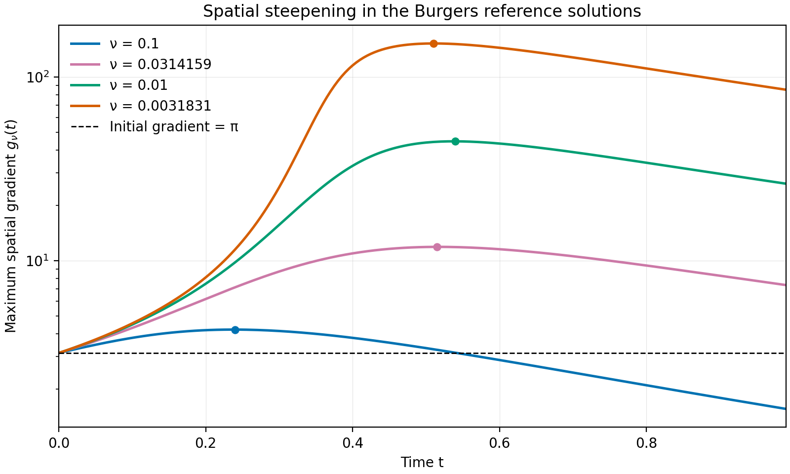
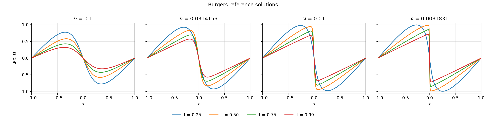

# Research context

This independent study investigates collocation dynamics in physics-informed
neural networks, with a possible publication as its longer-term objective.
This document records the scientific purpose, study plan, and decisions that
connect the study phases. Campaign-specific reasoning and execution instructions
belong in campaign READMEs, comparisons and brief interpretation in
[results](results.md), and setup instructions in the [repository README](../README.md).

## Research questions and working hypotheses

1. How does the benefit of point-adaptive collocation over sampling baselines
   change across solution-sharpness regimes, for solution and PDE-residual error?
2. Does adding stochastic diffusion to PACMANN improve solution and PDE-residual
   accuracy, and does that effect depend on the solution regime?

Our intuition motivates these questions; neither benefit is established.
Sharp solution gradients and coordinate gradients of the residual score are
different quantities. The study must measure solution sharpness independently
of adaptive point placement and evaluate both global and feature-region error.
Solution error and independently evaluated PDE-residual error are distinct
outcomes; improvements in one do not imply improvements in the other. Point
histories help interpret these outcomes. Upstream reproduction checks the
implementation; the main objective is a controlled comparison across regimes.

## Study design principles

Use controlled comparisons with matched settings except for the variables under
study, and disclose deviations needed for upstream reproduction. Pair seeds,
initialization, and initial point designs where applicable. Separate tuning from
evaluation and freeze selected settings before evaluation, with a fair tuning
policy and disclosed costs for competing methods.

Validate reference solutions against the PDE parameters and document numerical
accuracy when generating new data. Evaluate on fixed reference sets independent
of collocation points, with metrics and model-selection rules chosen before
execution. Measure sharpness and feature regions independently of adaptive
sampling. Report repeated-seed variability, unfavorable outcomes, missing runs,
and scientifically consequential deviations. Interpret findings within the
tested problems, parameters, and evaluation conditions.

## Research workstreams

Use four persistent branches, retaining each workstream's history:

- `dataset-validation`: reference generation, validation scripts, and evidence.
- `hyperparameter-tuning`: development campaigns, configurations, and selections.
- `analysis`: exploratory post-processing and reproducible comparisons awaiting
  synthesis; transfer accepted evidence to `main` when reporting the study.
- `main`: accepted implementations and conclusions, frozen evaluation settings,
  and full evaluation results.

Transfer selected code, configurations, or conclusions with the source commit.
Avoid whole-branch merges that import unrelated campaigns. Branch separation
organizes the repository; independent tuning and evaluation seeds and frozen
settings provide scientific separation.

## Reference validation and current evidence

The collaborator's Chebyshev-collocation/Radau Burgers solver provides generated
references. At viscosity `0.01/pi`, N1024 was checked against PACMANN on its
original grid and accepted for this benchmark; see the
[validation result](results.md#generated-burgers-reference-validation).
Other viscosities require their own numerical-accuracy checks.

The controlled N1024 sigma sweep completed fifteen runs over three paired
development seeds at `nu = 0.01/pi`. It selected `sigma = 1e-4` by mean final
solution relative L2, then assessed residual error at that same setting. This
candidate applies only at this viscosity; it does not select settings for other
viscosities. See the [development result](results.md#n1024-diffusion-development-selection).
Earlier pilot and tuning artifacts remain in Git history or on
`hyperparameter-tuning`.

The [first frozen-setting evaluation](../output/burgers/burgers_nu_0p0031830989_10seed/README.md)
completed all 50 planned runs across five methods and ten independent paired
evaluation seeds at this viscosity. The selected diffusion candidate did not
improve mean solution or residual error over PACMANN; see the
[evaluation results](results.md#frozen-n1024-ten-seed-evaluation). This evaluates
the development selection on new seeds before expansion across viscosity regimes.
It does not establish how method benefits change with sharpness. The campaign
README records the execution and timing conditions.

At `nu = 0.01`, a separate three-seed development sweep completed all 15 planned
runs and selected **sigma = 1e-3**. The winner is inside the tested positive range,
so no search expansion is needed. The accepted conclusion comes from
`hyperparameter-tuning` commit `2baa9dd`; its artifacts remain on that branch at
`output/burgers/burgers_nu_0p01_sigma_*/`. See the
[selection result](results.md#diffusion-development-selection-at-nu-001).
The separate [ten-seed evaluation](../output/burgers/burgers_nu_0p01_10seed/README.md)
completed all 50 planned runs across the five methods. All use seeds 4000–4009,
with the earlier campaign's training and evaluation controls and the separately
selected sigma. See the [evaluation results](results.md#frozen-evaluation-at-nu-001).

Generated N1024 references at `nu = 0.01`, `0.05`, and `0.1` passed structural
and loader checks. These checks do not independently certify numerical accuracy
at those viscosities. The `nu = 0.01` evaluation proceeded with that limitation.
The separate `nu = 0.1` development sweep completed 21 runs, including one
approved lower-boundary expansion, and selected the positive `sigma = 1e-5` by
mean final solution relative L2. Its accepted results and artifacts are on
[`hyperparameter-tuning`](https://github.com/hierr/pinn-collocation-dynamics/commit/1968b350a5d44adc9180782406357c2c8763be92),
using training source commit
[`0948ad9`](https://github.com/hierr/pinn-collocation-dynamics/commit/0948ad936fb32502c19f0b174572866799ca1285).
The frozen five-method, ten-seed evaluation now uses this value and the
separate N1024 reference; see its [protocol](../output/burgers/burgers_nu_0p1_10seed/README.md)
and the [selection result](results.md#diffusion-development-selection-at-nu-01).
The `nu = 0.05` reference has no approved PINN campaign.

## Parameterized sharpness study

The core Burgers comparison uses viscosities `0.1`, `pi/100`, `0.01`, and
`0.01/pi` to span relatively smooth through sharply varying solutions within
this study. Tune diffusion separately at each viscosity with development seeds,
then freeze settings before ten-seed comparisons of fixed Hammersley, upstream
random resampling, RAD, PACMANN, and PACMANN with diffusion. Retain the reference
accuracy limitations described above. Other PDE families can follow later.

The `pi/100` case was added after inspecting the existing reference profiles
to fill the spatial-gradient gap between `0.1` and `0.01`. Its N1024 reference
originates at dataset commit `52b9359` and was transferred unchanged from
`hyperparameter-tuning` commit `cb6c6e8`, which retains the separate tuning protocol.
Structural, constraint, and loader checks passed; these checks do not
independently certify numerical accuracy. Its
[ten-seed protocol](../output/burgers/burgers_nu_0p031415927_10seed/README.md)
is prepared with the shared controls, but diffusion sigma must be selected on
development seeds and frozen before execution.

This design tests performance after local tuning at each viscosity. It does not
test transfer of one fixed sigma across the range. Disclose tuning costs and
apply a fair tuning policy for competing methods. A ranking at one viscosity
alone does not answer how relative benefit changes with sharpness.

The three existing campaign protocols fix the viscosities, tuning decisions,
evaluation seeds, point populations, and training budgets. The prepared
`pi/100` protocol retains those controls with its diffusion coefficient pending.
The controlled study matches interior PDE populations and fixed constraints
across methods, while retaining
the shared upstream optimizer schedule and its L-BFGS stopping behavior.
Feature-region definitions and the cross-regime performance analysis remain
separate work.

The trainer loads the generated reference selected by YAML and keeps training
separate from final-checkpoint evaluation. Fixed Hammersley, upstream random
resampling, RAD, PACMANN-Adam, and PACMANN with diffusion are implemented.
The template retains upstream RAD settings rather than separately tuning RAD;
the final protocol must disclose this tuning policy and the methods' costs.
Reference characterization below describes the selected regimes; feature-region
error evaluation remains future work. The general settings template is not an
approved campaign.

Accepted training and evaluation changes were transferred from `59e2de8`, with
plot improvements from `95c02f8`. Tuning evidence remains on its development
branch; these transfers do not import its campaigns.

### Reference characterization and regime coverage

This characterization was formalized after the initial campaigns, using only
the reference solutions. It describes the accepted coverage without changing
the frozen training settings, model-selection rules, or error metrics.

Use the campaign domain `[-1, 1] × [0, 0.99]`, with the native 1,025
Chebyshev-Lobatto spatial nodes and 199 saved times at spacing `0.005`.
Differentiate each snapshot's Chebyshev interpolant in space and define

$$
g_\nu(t_j) = \max_i |\partial_x u_\nu(x_i,t_j)|,
\qquad G_\nu = \max_j g_\nu(t_j).
$$

Also record the sampled time of the peak and the solution amplitude
`max_i |u(x_i,t_peak)|` at that time. Maxima are evaluated at the native nodes
and saved times. They are numerical descriptors, not bounds on continuous
maxima or an independent certification of reference or derivative accuracy.
The common initial condition `-sin(pi*x)` has maximum spatial gradient `pi`.

| Viscosity | Relative regime | Peak gradient G | Peak time | Amplitude at peak |
| --- | --- | ---: | ---: | ---: |
| 0.1 | Relatively smooth | 4.211 | 0.240 | 0.7836 |
| pi/100 | Intermediate | 11.873 | 0.515 | 0.8228 |
| 0.01 | Steep | 44.566 | 0.540 | 0.9307 |
| 0.01/pi | Steepest tested | 151.933 | 0.510 | 0.9813 |



The reference solution slices below use the same times as the run diagnostics
(`0.25`, `0.50`, `0.75`, and `0.99`), with shared axes and time colors.



Regime labels are relative to this comparison. Viscosity also changes amplitude
and temporal evolution, so performance differences across these cases cannot be
attributed solely to sharpness.

The four viscosities define the current coverage and stopping point for viscosity
selection. Keep `nu = 0.05` outside the core comparison. Treat `nu = 0.001` as an
optional sharper extension after a separate reference-convergence check within
an agreed computational budget. Additional viscosities require a specific
coverage objective and protocol approval.

Reproduce the table's numerical descriptors and both figures from the repository
root using the [documented environment](../README.md#setup-and-execution):

```sh
venv/bin/python -m scripts.post_processing.characterize_burgers_references
```

The [script](../scripts/post_processing/characterize_burgers_references.py) reads
the reference paths and domains from the four campaign YAMLs, including the
prepared `pi/100` protocol. It prints the descriptors and writes the two figures;
it does not modify datasets or
campaign artifacts.

## Accepted controls and evaluation policy

- Match interior PDE point counts from the start and keep identical boundary
  and initial-condition constraints fixed across methods. Remove the released
  implementation's method-dependent inclusion of constraints in the PDE loss.
- Match network architecture, loss weights, and optimizer stages and budgets
  across methods. Start with shared settings across viscosities; any change
  needs a stated experimental rationale. Record actual optimizer work and
  runtime, since equal training schedules do not imply equal computation.
- The earlier `nu = 0.01/pi` tuning included zero as an eligible candidate.
  For later development phases, ordinary PACMANN at zero is a comparison baseline
  only. Select the positive sigma with the lowest arithmetic mean final solution
  relative L2 over all three development seeds; exact ties favor the smaller
  positive sigma, even if zero outperforms every positive setting. A positive
  boundary winner triggers two additional values extending the search two
  decades on that side, with at most two expansion rounds. Then freeze the best
  tested positive sigma and disclose any remaining boundary limitation.
  Evaluate residual error at the same solution-selected sigma; do not select a
  second value for residual error or combine outcomes into an undeclared score.
  Report improvements and tradeoffs separately.
- Evaluate solution error against validated reference values on fixed
  coordinates. Evaluate PDE-residual RMS on a common fixed interior evaluation
  set independent of point adaptation, using derivatives of the trained PINN.
  Training residuals at each method's own collocation points are diagnostics,
  not the residual comparison. Report boundary and initial-condition errors
  separately; do not normalize residual error by the zero exact residual.
- Use ordinary relative L2 and MSE on a common uniform solution grid: initially
  1,024 spatial points including the boundaries, and the 199 native uniformly
  spaced reference times through `0.99`. Interpolate the generated Chebyshev
  reference only in space using barycentric interpolation; infer the PINN
  directly at these coordinates. Count each space-time point equally. Use
  ordinary RMSE for boundary and initial-condition errors, and a fixed uniform
  interior midpoint grid for residual RMS. Check evaluation resolution before
  tuning each sharper regime.
- Define sharpness and feature regions from the reference solution independently
  of adaptive sampling. Compare method benefits across regimes using global and
  feature-region errors, rather than inferring a sharpness effect from a single
  viscosity or method ranking.
- Freeze settings before ten-seed evaluation using seeds excluded from tuning
  and previously inspected readiness runs. Pair seeds across methods and verify
  matching initial weights and point designs. Use final-model errors, retain
  individual outcomes and failures, and report means, sample variability, and
  paired comparisons. Do not retune on the final evaluation results.

## Decisions and open dependencies

- Keep the two research questions connected through a diffusion ablation and
  comparisons across regimes; a useful result for one does not require a
  positive result for the other.
- Treat tuning as scientific development and the frozen ten-seed comparisons as
  the main evaluation evidence. Engineering readiness checks are separate.
- At `nu = 0.01`, the completed ten-seed evaluation observed lower mean
  solution and residual errors for the selected `sigma = 1e-3` than for
  PACMANN without diffusion, with improvements in seven and nine paired seeds,
  respectively. This is setting-specific evidence on a generated reference
  without independent numerical-accuracy certification; it does not establish
  a sharpness effect. See the [results](results.md#frozen-evaluation-at-nu-001).
- Retain DeepXDE 1.14's existing L-BFGS driver for the first frozen comparison,
  matching the procedure used for sigma selection. It may exceed the configured
  stage iteration and function-evaluation limits; report actual iterations,
  function evaluations, and runtime rather than claiming identical computation.
  A strict-cap change would require reviewing tuning under that changed training
  procedure.
- At `nu = 0.01/pi`, doubling the solution grid from 1,024 to 2,048 spatial
  points changed relative L2 by less than 0.003% relative in a six-model check.
  Uniform-grid and native-grid quadrature scores differed by less than 0.25%
  relative. Recheck resolution for sharper regimes.
- Complete feature-region definitions and the cross-regime analysis before
  making broader sharpness claims. Retain reference-accuracy limitations and
  seek approval for extensions beyond the four selected viscosities. Negative or
  uncertain outcomes remain valid results within the tested scope.

## Supporting references

- [NeurIPS paper checklist](https://neurips.cc/public/guides/PaperChecklist):
  experimental settings, reproducibility, uncertainty, and compute reporting.
- [Research-code release guidance](https://github.com/paperswithcode/releasing-research-code):
  documented training, evaluation, environments, and saved artifacts.
- [Cawley and Talbot, 2010](https://www.jmlr.org/papers/v11/cawley10a.html):
  selection bias and the distinction between selection and evaluation.
- [Sivaprasad et al., 2020](https://proceedings.mlr.press/v119/sivaprasad20a.html):
  accounting for hyperparameter tuning effort in method comparisons.
