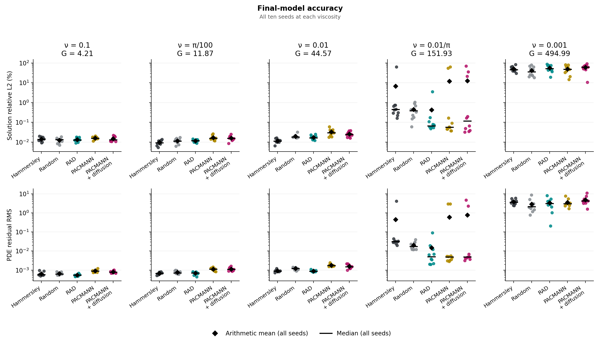
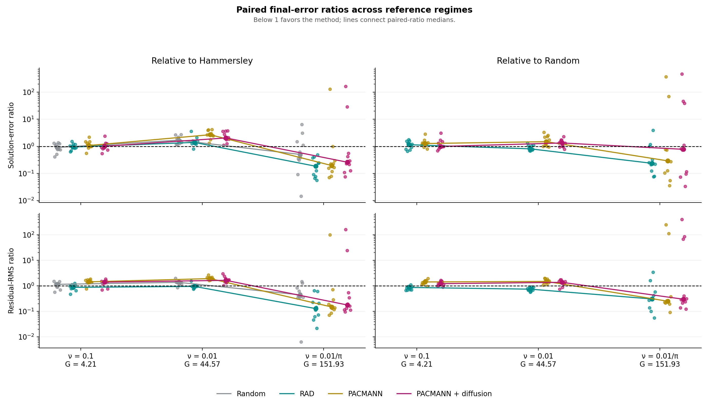
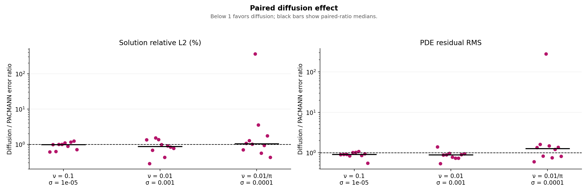
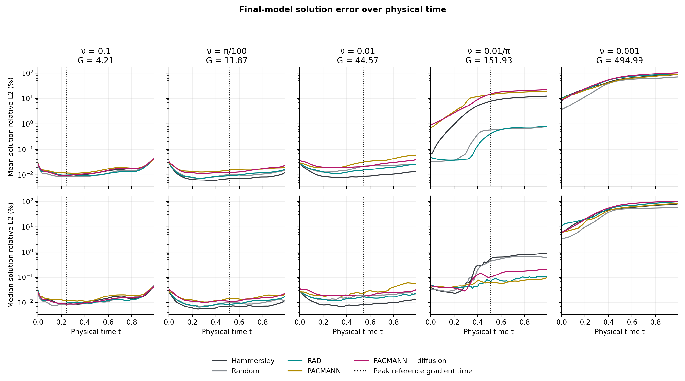

# Results for peer review

This compact submission preserves all 250 final evaluation records: five
viscosities, five methods, and seeds 4000–4009. All primary summaries retain
unfavorable outcomes. The [review guide](peer_review.md#study-design) explains
pairing, tuning, final-checkpoint evaluation, reference checks, and limitations.

The figures were generated from the saved outputs of all 250 runs at
[Git commit `4562077`](https://github.com/hierr/pinn-collocation-dynamics/tree/456207722c67ce4b11856efc3f4ace6f22f0c3e5).
The finished figure files were copied unchanged into this branch from the later
[commit `6e7a638`](https://github.com/hierr/pinn-collocation-dynamics/tree/6e7a638383fe0e04d9d999a2cc491c313f587cc8).
The figures below show all five viscosities, including pi/100, which was omitted
from the presentation's main comparison figures for readability.

## Final-model accuracy

Full-seed arithmetic means are the primary summaries. Medians describe typical
outcomes; neither favorable medians nor supplementary trimmed means remove seeds
from the comparison. SD is the sample standard deviation, not a confidence
interval. These descriptive rankings do not establish statistical significance.

| Viscosity | Method | Solution L2 (%), mean ± SD | Median (%) | Residual RMS, mean ± SD | Median RMS |
| --- | --- | ---: | ---: | ---: | ---: |
| 0.1 | Hammersley | 0.01417 ± 0.0036669 | 0.013809 | 0.00064472 ± 0.00016194 | 0.00057915 |
| 0.1 | Random | 0.012496 ± 0.0035691 | 0.013523 | 0.00065581 ± 0.00010099 | 0.00062842 |
| 0.1 | RAD | 0.013526 ± 0.0031563 | 0.012868 | 0.00054109 ± 6.55e-05 | 0.00054243 |
| 0.1 | PACMANN | 0.015801 ± 0.002641 | 0.015571 | 0.00090607 ± 0.00014575 | 0.00089072 |
| 0.1 | PACMANN + diffusion | 0.014639 ± 0.0043371 | 0.012946 | 0.00080664 ± 0.00011878 | 0.00077653 |
| pi/100 | Hammersley | 0.0096267 ± 0.0027322 | 0.0092952 | 0.0006763 ± 9.3294e-05 | 0.00067779 |
| pi/100 | Random | 0.011568 ± 0.0034111 | 0.011159 | 0.0007676 ± 0.00014348 | 0.00070849 |
| pi/100 | RAD | 0.011514 ± 0.0018647 | 0.01195 | 0.00068229 ± 0.00011792 | 0.00070368 |
| pi/100 | PACMANN | 0.016749 ± 0.0047115 | 0.015652 | 0.0011143 ± 0.000203 | 0.0011171 |
| pi/100 | PACMANN + diffusion | 0.015872 ± 0.0044469 | 0.01551 | 0.0011324 ± 0.00024117 | 0.0010935 |
| 0.01 | Hammersley | 0.011557 ± 0.0028237 | 0.011123 | 0.00091651 ± 0.00012836 | 0.00090408 |
| 0.01 | Random | 0.019498 ± 0.0045695 | 0.018159 | 0.0012061 ± 0.00017561 | 0.0012227 |
| 0.01 | RAD | 0.017237 ± 0.0043141 | 0.016385 | 0.00089022 ± 9.3974e-05 | 0.00086886 |
| 0.01 | PACMANN | 0.03244 ± 0.013059 | 0.029702 | 0.0018012 ± 0.00026818 | 0.0017293 |
| 0.01 | PACMANN + diffusion | 0.025728 ± 0.007857 | 0.024191 | 0.001571 ± 0.00039841 | 0.0015128 |
| 0.01/pi | Hammersley | 6.7951 ± 20.087 | 0.44533 | 0.44446 ± 1.3091 | 0.031524 |
| 0.01/pi | Random | 0.44794 ± 0.33274 | 0.3848 | 0.020083 ± 0.0095252 | 0.017318 |
| 0.01/pi | RAD | 0.42503 ± 1.0946 | 0.066417 | 0.014892 ± 0.027241 | 0.0050433 |
| 0.01/pi | PACMANN | 11.913 ± 25.053 | 0.056589 | 0.59393 ± 1.2434 | 0.0048602 |
| 0.01/pi | PACMANN + diffusion | 12.729 ± 23.518 | 0.11632 | 0.77939 ± 1.5587 | 0.0048676 |
| 0.001 | Hammersley | 51.035 ± 16.178 | 46.156 | 3.7783 ± 1.2063 | 3.5942 |
| 0.001 | Random | 42.213 ± 22.604 | 36.009 | 2.8818 ± 2.3532 | 2.1248 |
| 0.001 | RAD | 56.138 ± 21.72 | 52.003 | 3.3842 ± 2.2494 | 3.1354 |
| 0.001 | PACMANN | 49.135 ± 22.876 | 48.272 | 3.5207 ± 1.7707 | 3.0642 |
| 0.001 | PACMANN + diffusion | 60.69 ± 22.408 | 61.536 | 4.8614 ± 2.6527 | 4.1867 |

At nu = 0.01/pi, PACMANN has the lowest solution-error median, but two seeds
(4002 and 4006) have solution L2 errors of approximately 55.09% and 63.50%.
These are finite, completed outcomes and remain in all primary summaries.
At nu = 0.001, both means and medians are large across all methods; random
resampling has the lowest mean and median for both metrics.

## Paired comparisons

Ratios compare the same seed and viscosity. Values below one favor the adaptive
method over the named baseline. Lines connect median paired ratios for
visualization; viscosities are not pooled as independent replications.

These are medians of same-seed ratios, rather than ratios of method medians:

| Viscosity | Median diffusion/PACMANN solution ratio | Median residual ratio | Lower solution errors | Lower residual errors |
| --- | ---: | ---: | ---: | ---: |
| 0.1 | 0.985 | 0.913 | 7/10 | 7/10 |
| pi/100 | 0.962 | 1.025 | 7/10 | 5/10 |
| 0.01 | 0.869 | 0.886 | 7/10 | 9/10 |
| 0.01/pi | 1.036 | 1.277 | 4/10 | 4/10 |
| 0.001 | 1.248 | 1.326 | 4/10 | 2/10 |

Diffusion lowers both arithmetic mean errors relative to PACMANN at nu = 0.1
and 0.01. At pi/100, it lowers mean solution error but raises mean residual RMS;
at 0.01/pi and 0.001, it raises both. No general diffusion benefit is established.

## Exploratory physical-time evidence

These curves describe the final models over the PDE time coordinate.
Relative L2 at each time uses that time's reference norm, which changes as the solution decays. Dotted lines mark peak reference-gradient times rather than detected shock onset.

At nu = 0.01/pi, PACMANN's typical accuracy improves relative to the sampling
baselines once the reference has developed a steep front. Selected times,
inspected after observing the curves, illustrate this conditional finding:

| Physical time | PACMANN median solution L2 (%) | Hammersley median (%) | PACMANN lower than Hammersley |
| --- | ---: | ---: | ---: |
| 0.25 | 0.0461 | 0.0281 | 3/10 seeds |
| 0.75 | 0.0705 | 0.7718 | 9/10 seeds |
| 0.99 | 0.0970 | 0.8867 | 9/10 seeds |

Against random resampling, PACMANN has lower solution errors in seven of ten
pairs at t = 0.75 and eight at t = 0.99. Large-error runs still make its
later-time mean poor. A lower method median also need not imply more paired
wins against every method: at t = 0.99, PACMANN's median is lower than RAD's,
but PACMANN wins in only three of ten same-seed comparisons.

The extension to nu = 0.001 does not reproduce that favorable typical-accuracy
pattern. All methods have appreciable errors already at t = 0, and by t = 0.75
median errors range from approximately 54.85% to 92.61%. These outcomes are not
explained by a few unfavorable seeds alone.

Each score covers the whole spatial domain. This post hoc analysis does not
establish that improvement occurs inside the front or that sharpness causes
it. Per-viscosity tuning, coupled changes in solution amplitude and evolution,
and reference-accuracy limitations also constrain interpretation.

## Inspecting the retained evidence

| Viscosity | Per-seed records and campaign tables |
| --- | --- |
| 0.1 | [Campaign](../output/burgers/burgers_nu_0p1_10seed/README.md) |
| pi/100 | [Campaign](../output/burgers/burgers_nu_0p031415927_10seed/README.md) |
| 0.01 | [Campaign](../output/burgers/burgers_nu_0p01_10seed/README.md) |
| 0.01/pi | [Campaign](../output/burgers/burgers_nu_0p0031830989_10seed/README.md) |
| 0.001 | [Campaign](../output/burgers/nu_0p001/burgers_nu_0p001_10seed/README.md) |

The complete [PACMANN-Adam seed-4000 example at nu = 0.01/pi](../output/burgers/burgers_nu_0p0031830989_10seed/pacmann_adam/seed_4000)
includes diagnostics, predictions, and model weights. Its final solution error is
0.0454075% and independent residual RMS is 0.00530195. It is an illustrative
successful run, not a substitute for the distributions above.

For independent aggregate checks, read `metrics.json` for every seed, multiply
`final_relative_l2` by 100 for percentages, and use ordinary arithmetic means,
sample SD with denominator n−1, and medians. Pair method/baseline values by seed.
The [artifact dictionary](output_format.md) defines the fields. The short demo
uses reduced budgets and contributes no outcomes to these scientific tables.
